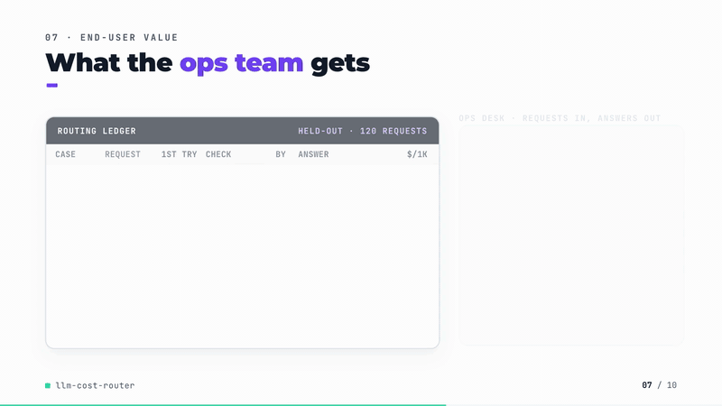
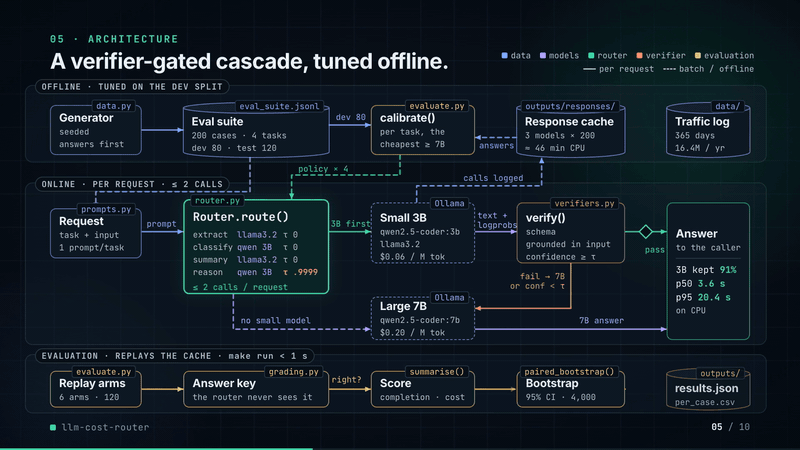

# llm-cost-router

[](https://github.com/kavya2693/llm-cost-router/actions/workflows/ci.yml)


Send each LLM request to the cheapest self-hosted model likely to get it right, check the
answer with a cheap verifier, and pay for the large model only when the check fails. Measured
on a 200-case suite with known answers, against sending everything to the large or the small model.

[](docs/demo/demo.mp4)

*84-second silent walkthrough. Click for the full video ([MP4, 5 MB](docs/demo/demo.mp4)).*

📄 **Audit report:** every figure and assumption in the video, traced to its source — [PDF](docs/demo/AUDIT_REPORT.pdf) · [Word](docs/demo/AUDIT_REPORT.docx) · [Markdown](docs/demo/AUDIT_REPORT.md)

## At a glance

| | |
|---|---|
| **Problem** | About 16.4 million self-hosted LLM requests a year (order extraction, ticket classification, shift summaries, planner arithmetic) all go to the 7B model, because nobody can tell per request when a 3B answer is safe to keep. |
| **Approach** | A cascade: a small model answers first, a deterministic per-task verifier plus a token-probability confidence decides whether to keep it, and only a failed check pays for Qwen2.5-Coder 7B. Which small model and which threshold per task is tuned on a dev split, never hand-set. |
| **Result** | On 120 held-out cases: **82.5%** completion against 85.0% for the large model alone, at **$0.0176** per 1k requests against $0.0452 (**61% cheaper**). Projected yearly bill at logged traffic: **$779 → $247**. |
| **What didn't win** | Reasoning. The confidence threshold matched the large model on dev (95% vs 95%) and fell to **63% vs 77%** held out, because the 3B model copies a wrong product into its `ANSWER:` line with near-certainty. Escalation also pushes p95 latency to 20.4 s against 12.6 s. |

## Architecture



The same `Router` serves live traffic and the evaluation. Live, its caller hits Ollama; in
evaluation and CI, its caller replays the committed response cache, so every number in this README
comes from the code path a deployment would run.

```mermaid
flowchart LR
  subgraph SRC["Sources"]
    GEN["Seeded case generator<br/>data.py · scripts/generate_data.py"]
    SUITE[("Eval suite, 200 cases + answers<br/>data/eval_suite.jsonl")]
    TRAFFIC[("Daily request volume, 365 days<br/>data/traffic_daily.csv")]
  end

  subgraph FEAT["Data / Features"]
    PROMPT["One prompt per task + prompt hash<br/>prompts.py"]
    CACHE[("Responses with token logprobs<br/>outputs/responses/*.jsonl")]
  end

  subgraph MOD["Models (Ollama, temperature 0)"]
    SMALL["Small: Qwen2.5-Coder 3B or Llama 3.2 3B<br/>client.py ollama_call()"]
    LARGE["Large: Qwen2.5-Coder 7B<br/>client.py ollama_call()"]
  end

  subgraph DEC["Decision"]
    POLICY["Per-task policy: first model + threshold<br/>evaluate.py calibrate()"]
    ROUTER["Cascade, at most two calls<br/>router.py Router.route()"]
    VERIFY["Structural check + logprob confidence<br/>verifiers.py verify()"]
  end

  subgraph OUT["Outputs"]
    ANSWER["Answer + final model, cost, latency<br/>router.py Routed"]
    RESULTS[("results.md · results.json · per_case.csv<br/>outputs/")]
  end

  subgraph EVAL["Evaluation / Monitoring"]
    GRADE["Answer-key grader, never seen by the router<br/>grading.py"]
    ARMS["Six arms, paired bootstrap, annual cost<br/>evaluate.py evaluate()"]
    LEAK["Wrong answers let through<br/>evaluate.py summarise()"]
    CI["Reproduction gate: results must not change<br/>.github/workflows/ci.yml"]
  end

  GEN -->|"cases with fixed answers"| SUITE
  GEN -->|"daily counts per task"| TRAFFIC
  SUITE -->|"request text"| PROMPT
  PROMPT -->|"prompt"| ROUTER
  POLICY -->|"TaskPolicy"| ROUTER
  ROUTER -->|"call(first model)"| SMALL
  SMALL -->|"Response"| VERIFY
  VERIFY -->|"pass and confidence ≥ threshold"| ANSWER
  VERIFY -. "fail: escalate" .-> LARGE
  LARGE -->|"Response"| ANSWER
  SMALL -->|"append"| CACHE
  LARGE -->|"append"| CACHE
  CACHE -. "replay caller (make run, CI)" .-> ROUTER
  ANSWER -->|"output"| GRADE
  SUITE -->|"answer key"| GRADE
  GRADE -->|"correct / wrong"| ARMS
  GRADE -->|"verifier passed, grader failed"| LEAK
  TRAFFIC -->|"annual volume, gaps filled"| ARMS
  ARMS -->|"tables"| RESULTS
  GRADE -. "dev-split completion" .-> POLICY
  RESULTS -. "git diff must be empty" .-> CI

  classDef data fill:#7fa8ff,stroke:#4f78d6,color:#0b1020
  classDef models fill:#b9a2ff,stroke:#8a6fe0,color:#0b1020
  classDef decision fill:#3fd8a8,stroke:#22a77f,color:#0b1020
  classDef evaluation fill:#f2c46d,stroke:#c99a3c,color:#0b1020
  classDef risk fill:#ff8a73,stroke:#d9604a,color:#0b1020
  class GEN,SUITE,TRAFFIC,PROMPT,CACHE,RESULTS data
  class SMALL,LARGE models
  class POLICY,ROUTER,VERIFY,ANSWER decision
  class GRADE,ARMS,CI evaluation
  class LEAK risk
```



Solid edges are the request path; dotted edges are the escalation fallback, the cache replay, the
dev-split tuning loop and the CI gate.

### Components

| Component | Responsibility | File |
|---|---|---|
| Case and traffic generator | Fixes each answer first, then writes the email, ticket, report or problem around it; writes a year of daily volume with gaps and spikes | [`data.py`](src/llm_cost_router/data.py), [`generate_data.py`](scripts/generate_data.py) |
| Prompts | One prompt per task, identical for every model; a hash of it keys the cache | [`prompts.py`](src/llm_cost_router/prompts.py) |
| Model client and cache | Calls Ollama at temperature 0 with token log-probabilities; appends every response; replays them; invalidates on prompt change | [`client.py`](src/llm_cost_router/client.py) |
| Verifiers | What the router can check without an answer key: JSON keys and grounding, one known label, word limit and numbers from the report, a final `ANSWER:` line; plus a confidence per task | [`verifiers.py`](src/llm_cost_router/verifiers.py) |
| Router | Small model first, keep the answer if the verdict passes and confidence clears the threshold, otherwise one call to the large model | [`router.py`](src/llm_cost_router/router.py) |
| Grader | The answer key the router never sees; tested against deliberately broken outputs first | [`grading.py`](src/llm_cost_router/grading.py) |
| Calibration and evaluation | Tunes the per-task policy on dev, replays six arms on the held-out split, paired bootstrap, projected annual cost | [`evaluate.py`](src/llm_cost_router/evaluate.py) |
| Price table and settings | Per-million-token prices, model tiers, output caps, paths, seed | [`config.py`](src/llm_cost_router/config.py) |
| CLI | `collect` fills the cache from Ollama; `evaluate` replays it and writes `outputs/` | [`cli.py`](src/llm_cost_router/cli.py) |

### Design decisions

| Decision | Options considered | Chosen | Trade-off |
|---|---|---|---|
| How to decide per request ([ADR-0001](docs/adr/0001-verifier-gated-cascade-tuned-on-dev.md)) | Static routing by task type; learned difficulty router (RouteLLM family); cascade with a cheap verifier; self-consistency or LLM-as-judge | Cascade with a deterministic verifier | Uses what the small model actually said, with no training data; every escalated request pays both latencies (p95 20.4 s vs 12.6 s) |
| How the policy is set | Hand-set threshold; one small model and structural check for everything; per-task model and threshold tuned on dev | Tuned on 20 dev cases per task, cheapest setting that completes at least as many dev cases as the large model | Cuts wrong answers let through from 27 to 16; 20 cases is thin, and the reasoning threshold did not transfer to held-out |
| Where ground truth comes from | Model judging model; hand labels; answer fixed by the generator before the text | Generator fixes the answer first | No model grades another model and the router never sees the key; coverage is limited to what the generator writes |
| Confidence signal for reasoning | Mean token probability over the answer; minimum probability of the digits after `ANSWER:`; re-checking the written arithmetic | Minimum digit probability after the final `ANSWER:` | Cheap and free of extra calls, but it measures copying, not arithmetic; arithmetic re-checks caught only pure multiplication slips |
| Reproducibility | Call models in every run; replay a committed response cache | Replay the cache; CI regenerates the suite and fails if `results.md` changes | Runs in under a second with no model server; CPU inference is not bit-for-bit deterministic, so the cache, not the models, is the source of truth |
| Model and decoding choices | phi4 14B as the large arm; Ollama JSON mode for extraction; prompt-only JSON | Qwen2.5-Coder 7B as large; prompt-only JSON | phi4 could not cover 200 cases in the 45-minute CPU budget; grammar-constrained decoding ran about five times slower per token |

### Data contracts

| Stage | Artifact | Fields |
|---|---|---|
| Generator → everything | `data/eval_suite.jsonl`, one case per line | `id` str, `task` one of extraction/classification/summarization/reasoning, `difficulty` easy/hard, `split` dev/test, `input` str, `answer`: order dict (`order_id`, `customer`, `sku`, `quantity` int, `delivery_city`, `delivery_date` ISO or null) / label str / summary facts dict (`site`, `affected_orders` int, `cause_keywords`, `action_keywords`) / int |
| Generator → cost projection | `data/traffic_daily.csv` | `date` ISO, then one int column per task; a blank cell is a logging gap |
| Model client → cache | `outputs/responses/<model>.jsonl` | `case_id`, `model`, `prompt_hash`, `text`, `prompt_tokens` int, `completion_tokens` int, `latency_s` float, `token_logprobs` list of (token, logprob), `first_top` top-5 alternatives for the first three tokens |
| Verifier → router | `Verdict` | `passed` bool, `confidence` float in [0, 1], `reason` str |
| Calibration → router | `TaskPolicy` per task | `first` small model name or null (straight to large), `threshold` float |
| Evaluation → report | `outputs/per_case.csv`, `results.json`, `results.md` | `arm`, `id`, `task`, `difficulty`, `final_model`, `escalated` bool, `correct` bool, `cost_usd`, `latency_s` |

### Failure modes and fallbacks

| Situation | What the code does |
|---|---|
| Small answer malformed, ungrounded, truncated or under the threshold | Verifier fails and the request escalates to the 7B model; at most two calls per request |
| Task type with no tuned policy | `TaskPolicy(first=None)`: straight to the large model |
| Model call times out or the connection drops during collection | 1,200 s timeout per call, three attempts, each failure logged; the run is resumable and only fills cache misses |
| Prompt changed after answers were cached | The stored `prompt_hash` no longer matches, so the cached answer is ignored and `compact()` drops it |
| A model's cache is incomplete | That small model is left out of the comparison; if none is complete, or any needed answer is missing, `evaluate` exits non-zero and says to run `make models` |
| Gaps in the traffic log | Filled with the mean of the same weekday within four weeks either side |
| macOS 13 Metal crash | `OLLAMA_NUM_GPU=0` forces CPU inference |
| Confidently wrong small answer | **Not caught.** This is the reasoning failure above and the biggest listed gap |
| Large model times out while serving | **Gap.** `Router.route` has no timeout budget or retry of its own; the call error propagates |
| Small model drifts after a model or traffic change | **Gap.** Thresholds are fixed at calibration time; nothing re-tunes them or alarms on escalation rate |

### Path to production

This is a mapping of each local piece to what it would become in a hosted deployment, not a
description of a deployed system.

| Here | Production equivalent |
|---|---|
| Ollama on a laptop CPU | vLLM or TGI on GPU nodes, or a managed endpoint (SageMaker, Vertex AI), with log-probabilities enabled |
| `llm-cost-router` CLI and `Router.route()` | Stateless HTTP service behind the API gateway, with a per-call timeout and a latency budget for the escalation |
| `outputs/responses/*.jsonl` | Request and response log in object storage, queryable in a warehouse (S3 + Athena, or BigQuery) |
| Generator answer key | A sampled, human-labelled audit stream per task type |
| `calibrate()` on the dev split | Scheduled re-calibration (Airflow or Step Functions) on the latest labelled sample, promoted only if it holds completion against the large model |
| `outputs/results.md` | Dashboard of escalation rate, verifier pass rate, confidence distribution and audited wrong-let-through per task, with alerts on shifts |
| CI diff on `results.md` | Release gate: a new prompt, model or policy ships only after replaying the held-out set |
| `config.py` price table | Measured GPU-hour cost per model tier |

## The problem

An operations platform pushes about sixteen million LLM requests a year through self-hosted
models: pulling order fields out of customer emails, sorting support tickets into queues,
summarising warehouse shift reports, and working short arithmetic questions for planners. The
safe default is to send all of it to the biggest model the team runs, because a wrong order
quantity or a ticket in the wrong queue costs a person's time to find and fix. That default is
also where most of the inference bill goes, and most of those requests are routine: a 3B model
reads "PO-91039, 2099 units, ship to Riyadh" just as well as a 7B one.

The team wants to stop paying large-model prices for routine work without the completion rate
dropping, and it needs to know which task types that is actually safe for.

## Why it is hard

Picking a cheap model per task type is easy. Knowing, per request, when the cheap model got it
wrong is not, because at serving time there is no answer key. A router that keeps every small
answer saves the most money and silently ships every mistake. The only signal available is what
can be checked cheaply: whether the output is well formed, whether its values appear in the
request, and how confident the model was in its own tokens. Whether those signals separate right
answers from wrong ones is an empirical question, and it has a different answer per task.

## The approach

A cascade ([ADR-0001](docs/adr/0001-verifier-gated-cascade-tuned-on-dev.md)). Each request goes
first to a small model (Qwen2.5-Coder 3B or Llama 3.2 3B), its answer goes through a task-specific
verifier, and only a failed check pays for Qwen2.5-Coder 7B. The verifiers are deterministic:
extraction must be JSON with the right keys and every value found in the email; a classification
must name exactly one known label; a summary must stay under 40 words and use only numbers from
the report; a reasoning answer must end on an `ANSWER:` line. On top of that each verifier reads a
confidence from the model's token log-probabilities.

The key decision is that the policy is tuned, not hand-set. For each task type, the dev split (20
cases per type) picks which small model goes first, or none, and the confidence threshold, choosing
the cheapest setting that completes at least as many dev cases as the large model alone. Every
headline number below is on the 120 held-out cases. Ground truth comes from the generator, so no
model ever judges another model's answer.

## The result

Held-out split, 120 cases (30 per task type). Cost uses the stated price table in
[`config.py`](src/llm_cost_router/config.py): $0.06 per million tokens for the 3B models and $0.20
for the 7B model. Latency is measured CPU inference time per request on an M1 Pro laptop. Full
output: [`outputs/results.md`](outputs/results.md), run log: [`outputs/run_log.txt`](outputs/run_log.txt).

| Arm | Completion | Hard cases | Cost / 1k req | Cost saved | p50 s | p95 s | Answered by small | Wrong answers let through |
|---|---:|---:|---:|---:|---:|---:|---:|---:|
| all-large (Qwen2.5-Coder 7B) | 85.0% | 75.0% | $0.0452 | - | 5.8 | 12.6 | 0% | - |
| all-small (Llama 3.2 3B) | 80.0% | 70.0% | $0.0125 | 72% | 3.4 | 8.5 | 100% | - |
| all-small (Qwen2.5-Coder 3B) | 75.8% | 60.0% | $0.0134 | 70% | 4.2 | 8.7 | 100% | - |
| router, structural check only | 77.5% | 63.3% | $0.0152 | 66% | 4.3 | 9.4 | 96% | 27 |
| **router, tuned on dev** | **82.5%** | 71.7% | **$0.0176** | **61%** | 3.6 | 20.4 | 91% | 16 |
| oracle (perfect verifier) | 91.7% | 85.0% | $0.0178 | 61% | 4.2 | 10.9 | 88% | - |

Router minus all-large completion, paired bootstrap 95% interval: **[-7.5, +2.5] points**. At the
logged traffic volume (16.4 million requests a year) the projected bill falls from $779 to $247.

**The router did not hold completion steady; it lost 2.5 points, and all of the loss is in
reasoning.** Per task type, completion (cost per 1k requests):

| Arm | extraction | classification | summarization | reasoning |
|---|---|---|---|---|
| all-large | 93% ($0.062) | 87% ($0.034) | 83% ($0.039) | 77% ($0.047) |
| router, tuned on dev | 93% ($0.016) | 87% ($0.010) | 87% ($0.012) | **63%** ($0.033) |
| oracle (perfect verifier) | 93% ($0.021) | 87% ($0.013) | 97% ($0.014) | 90% ($0.022) |

What this says:

1. **Extraction, classification and summarization are safe to route.** The router matches or beats
   the large model on all three at a quarter to a third of the cost, and the policy tuned on dev sends
   them to the small model with no confidence threshold at all: the structural checks were enough.
2. **Reasoning is not, and the verifier is why.** On dev the threshold (accept a 3B answer only if
   its answer digits have probability above 0.9999) matched the large model exactly, 95% vs 95%. On
   the held-out cases the 3B model was wrong six times with that much confidence, for example:

   ```
   1. Calculate the cost of the chairs: 38 * 168 = 6264 AED
   2. Add the delivery fee: 6264 + 45 = 6309 AED
   ANSWER: 6309          (correct: 6429)
   ```

   The confidence is read at the final answer, which only copies a number the model already wrote,
   so it measures copying, not arithmetic. The honest policy for this suite is to send reasoning
   straight to the large model; I have not switched it, because that decision would come from the
   test split.
3. **The oracle shows where the money is.** A perfect verifier at the same cost would beat the large
   model by about seven points, because the small models get right some cases the 7B gets wrong. The
   gap between 82.5% and 91.7% is entirely verifier quality.
4. **Escalation costs latency in the tail.** The router's p50 is lower than the large model's, but
   its p95 is 20.4 s against 12.6 s, because an escalated request waits for the small attempt and
   then the large one.
5. **Tuning per task is worth having.** One small model for everything with only the structural
   checks lets 27 wrong answers through; the dev-tuned choice of model per task, plus the reasoning
   threshold, cuts that to 16.

On all 200 cases (dev included) the tuned router reaches 87.0% against 88.0% for the large model
at 59% lower cost, interval [-4.5, +2.5] points; the dev cases flatter it.

**Inference time.** Running every model on all 200 cases took 13.3 min (Qwen 3B), 11.8 min
(Llama 3.2) and 20.7 min (Qwen 7B), 45.8 minutes in all on CPU: just over the 45-minute budget
I set. phi4 (14B) was dropped as the large arm for this reason.

## How it works

```
request ──► small model (per-task choice) ──► verifier ──► pass & confidence ≥ threshold ──► answer
                                                  │
                                                  └── fail ──► Qwen2.5-Coder 7B ──► answer

dev split (80 cases)   ──► calibrate(): per task, cheapest {model, threshold} with completion ≥ large
test split (120 cases) ──► every arm replayed from outputs/responses/ ──► graded against the answer key
```

- `data.py` writes the 200 cases with their answers, plus a year of daily request volume per task.
  Hard cases carry traps: a second order number or quantity in the email, a ticket that mentions
  two topics, a shift report with a distracting second count, multi-step arithmetic with an
  irrelevant number.
- `prompts.py` holds one prompt per task, identical for every model, so arms differ only by model.
- `client.py` calls Ollama at temperature 0 and appends every response, with token log-probabilities,
  to `outputs/responses/<model>.jsonl`. A changed prompt invalidates its cached answer.
- `verifiers.py` is what the router sees; `grading.py` is the answer key it never sees.
- `router.py` is the cascade; `evaluate.py` tunes it on dev, runs every arm and the bootstrap.
- Stop condition: at most two calls per request, one small and one large.

## Running it

```bash
uv sync
make check     # ruff, format, mypy, pytest
make run       # regenerate the suite and replay all arms from the cache, under a second
make models    # call the models through Ollama to refresh the cache; ~46 min on CPU
docker build -t llm-cost-router . && docker run --rm llm-cost-router
```

`make run` and the Docker image need no model server or key: they replay the committed responses.
`make models` needs a local Ollama with `qwen2.5-coder:3b`, `qwen2.5-coder:7b` and `llama3.2`
pulled. On macOS 13, set `OLLAMA_NUM_GPU=0`; the Metal path crashes there.

## The data

The dataset is generated by the seeded script `scripts/generate_data.py` (`make data`) and sized to
the production problem: 200 evaluation cases, 50 per task type split evenly into easy and hard, and
365 days of request volume per task type (about 16.4 million requests a year). The production data
is proprietary.

Each answer is fixed before the text is written: the generator picks the order fields, the ticket
label, the shift facts or the arithmetic, then writes the email, ticket, report or problem around
them, with typos, distractor numbers and second topics in the hard half. The traffic log has
weekday shape, holiday peaks, incident spikes and logging gaps, which the projection fills from the
same weekday nearby.

## Tests

`make check` runs 14 tests, all with stubbed models. The two that matter most:

- `test_confidence_threshold_catches_what_the_schema_check_cannot` gives the router a small model
  that returns well-formed but wrong answers with low token probability, and checks that only the
  threshold, not the structural check, escalates them. That is the mechanism the reasoning result
  above shows failing on real outputs, where wrong answers came with high probability.
- `test_calibration_never_trades_completion_for_cost_on_dev` checks that the tuned policy never
  completes fewer dev cases than the large model, whatever it saves.

The grader was written and tested against deliberately broken outputs first (a distractor
quantity, a wrong null date, two labels, an over-long summary, an earlier `ANSWER:` line), because
every number depends on it. CI also regenerates the suite and replays the cache, and fails if
`outputs/results.md` changes.

## Known limitations

- **Biggest gap: the verifier for reasoning does not work.** Token probability at the answer
  cannot tell a confident wrong calculation from a right one. I tried re-checking the arithmetic
  written in the working against the cache; it catches only the pure multiplication slips, a small
  share of the errors, since most are in setting the problem up. A real fix is a second, different
  signal (a program-of-thought re-computation, or agreement between the two small models), each
  of which costs another call.
- 20 dev cases per task is thin. One case is five points, the 7B model itself scored 95% on dev
  reasoning and 77% held out, and the bootstrap interval on the router's deficit is ten points wide.
- The price table is an assumption, not a quote; self-hosted models have no list price. The saving
  is driven by the 3.3x price ratio between tiers. The measured CPU latencies are the independent
  check on cost, and they point the same way at the median and the other way in the tail.
- CPU inference with several threads is not bit-for-bit deterministic even at temperature 0. A
  second pass of the 3B model on this machine changed a handful of answers. The cache is what makes
  the README reproducible, not the models.
- Latency was measured on a laptop shared with other jobs; absolute seconds will differ elsewhere.
- Four task shapes, one prompt each, no retries with a better prompt before escalating, and only
  the 3B/7B size classes.

## Insights and learning

I picked this because "use the small model for easy requests" is advice everyone gives and almost
nobody measures per task with a real answer key. The part I cared about was the verifier, since a
router is only as good as its ability to notice its own mistakes.

The surprise was how cleanly the result split. On extraction, classification and summarization the
plain structural checks did all the work, and a confidence threshold added nothing. On reasoning
the confidence threshold looked perfect on dev and failed held out, and the reason was obvious once
I read the cached answers: the model computes a wrong product in its working and then copies it
into the answer line with near-certainty. I had been treating "confident at the answer" as
"confident in the answer".

What I got wrong at first: the first reasoning prompt let the coder model answer in Python or
LaTeX, and the grader marked correct `\boxed{}` answers as missing. I fixed the prompt to ask for
plain-text working and taught the grader the boxed form before collecting the final cache. I also
started with Ollama's JSON mode for extraction and dropped it: grammar-constrained decoding ran
about five times slower per token on CPU, and the prompt alone already produced bare JSON.

Next: send reasoning to the large model, then try agreement between the two small models as the
reasoning verifier, which costs one extra cheap call but uses a signal that does not come from the
same model's own working.

## License

MIT
