# llm-cost-router: demo video audit report

**Repository:** https://github.com/kavya2693/llm-cost-router  
**Numbers taken from commit:** `2ec9b2f` (outputs last changed in `2ec9b2f (2026-10-14 12:38:13 +0400)`)  
**Video:** `docs/demo/demo.mp4` (86.8 s, 1920x1080, 30 fps, silent)  
**Generated:** 2026-10-14 18:41  
**Automated checks:** 51 pass · 0 fail · 1 manual (of 52 figures)

## How to use this report

Every number or claim on screen has an ID (`F-01`, `F-02`, ...) and every modelling assumption has an ID (`A-01`, ...). Cite the ID. Each figure lists its source file, the exact column/row/key, the formula for derived numbers, and an automated check result. The change-impact matrix tells you which slides and files change if an input or assumption changes.

Types: **direct** = read straight from a repo output; **derived** = computed from direct values (formula given); **illustrative** = drawing or example, not data; **general knowledge** = context not produced by the repo.

### Regenerate

```bash
make run                                   # data/*, outputs/results.json|md, per_case.csv (replays the response cache, under a second)
.venv/bin/python docs/demo/source/tools/export_routing_log.py docs/demo/source/assets/routing_log.json
python3 docs/demo/source/tools/inject_sheet.py docs/demo/source/assets/routing_log.json outputs/results.json docs/demo/source/compositions --rows ext-023,cla-021,sum-026,rea-040,rea-021,cla-035
cd docs/demo/source && npx --yes hyperframes@0.8.156 check && npx --yes hyperframes@0.8.156 render -f 30 -q looks -o renders/llm-cost-router-master.mp4 && cd -
ffmpeg -y -i docs/demo/source/renders/llm-cost-router-master.mp4 -c:v libx264 -preset slow -crf 25 -pix_fmt yuv420p -movflags +faststart -an docs/demo/demo.mp4
python3 docs/demo/source/tools/build_audit_report.py docs/demo/source/audit/facts.yaml   # stills, checks, MD/DOCX/PDF
```

## 1. Figures

| ID | Shown on screen | Slides | Source | Column / row / key | How computed | Type | Check |
|---|---|---|---|---|---|---|---|
| F-01 | 3 industry chips | 01 | `author's framing` | - | - | general knowledge | manual: Context statement, not a repo output. |
| F-02 | 4 problem cards | 01 | `README 'The problem', 'Why it is hard'` | README lines 12-35 | - | general knowledge | ✓ verified |
| F-03 | 16.4M LLM requests a year / 16.4M / yr / 16.4M req | 02, 05, 08 | `outputs/results.json` | annual_requests (sum over 4 tasks = 16,394,979) | sum / 1e6, 1 decimal | derived | ✓ verified |
| F-04 | 4 tasks | 02, 05 | `outputs/results.json` | policy (one entry per task type) | count | direct | ✓ verified |
| F-05 | 3 self-hosted models / 3 models | 02, 05, 10 | `outputs/results.json` | model_seconds (one entry per model) | count | direct | ✓ verified |
| F-06 | 200 cases, known answers | 02, 05, 10 | `data/eval_suite.jsonl` | line count; every case has an 'answer' | count | direct | ✓ verified |
| F-07 | 3B $0.06 · 7B $0.20 per M tokens | 02, 05, 08 | `src/llm_cost_router/config.py:35-37` | MODELS usd_per_m_* | - | direct | ✓ verified |
| F-08 | wrong small answers ship silently | 02 | `outputs/results.json` | splits.test['router, structural check only'].wrong_accepted_small = 27 | > 0 | derived | ✓ verified |
| F-09 | lower bill / mostly small / answers checked | 03 | `outputs/results.json; src/llm_cost_router/router.py:61` | cost_per_1k_usd router < all-large; share_answered_small > 0.5; verify() runs on every small answer | - | derived | ✓ verified |
| F-10 | ≤ 2 calls / request; FALLBACK | 03, 05 | `src/llm_cost_router/router.py:54-66; README 'Stop condition'` | route(): one optional small call, one large call | - | direct | ✓ verified |
| F-11 | PO-51719 · Summit Auto Parts · LED-3580 · 20 · Sharjah · 2026-05-14; keep the 3B answer | 04, 07 | `demo:assets/routing_log.json (export of the repo's Router)` | id = ext-023: first_model, check_passed, escalated, output, input | - | direct | ✓ verified |
| F-12 | 6 confident wrong answers got through / 6 wrong answers passed at over 99.99% confidence | 04, 09 | `outputs/per_case.csv; demo:assets/routing_log.json` | arm = router, tuned on dev; task = reasoning; escalated = False; correct = False | count = 6; every confidence > 0.9999 | derived | ✓ verified |
| F-13 | Worked for orders, tickets and summaries | 04 | `outputs/results.json` | splits.test[arm].by_task[task].completion | router ≥ all-large for 3 tasks | derived | ✓ verified |
| F-14 | 80 practice · 120 test (practice = the dev split) | 05 | `data/eval_suite.jsonl` | split | count per split | direct | ✓ verified |
| F-15 | 3 models × 200 | 05, 10 | `outputs/responses/*.jsonl` | line counts | 200 lines in each of 3 files | direct | ✓ verified |
| F-16 | ≈ 46 min CPU | 05 | `outputs/results.json` | model_seconds (796.1 + 706.2 + 1240.3 s) | sum / 60 = 45.8 min, rounded | derived | ✓ verified |
| F-17 | 365 days | 05 | `data/traffic_daily.csv` | row count | - | direct | ✓ verified |
| F-18 | data.py, eval_suite.jsonl, evaluate.py calibrate(), outputs/responses/, data/, prompts.py, router.py Router.route(), Ollama (client.py), verifiers.py verify(), grading.py, summarise(), paired_bootstrap(), outputs/results.json, per_case.csv | 05 | `src/llm_cost_router/*.py; data/; outputs/` | file / def | - | direct | ✓ verified |
| F-19 | Router.route() table: orders llama3.2 no bar · tickets qwen 3B no bar · reports llama3.2 no bar · math qwen 3B .9999 (bar = confidence threshold τ) | 05 | `outputs/results.json` | policy[task].first, policy[task].threshold | - | direct | ✓ verified |
| F-20 | well formed / found in the request / confidence ≥ bar | 05 | `src/llm_cost_router/verifiers.py:59-149; router.py:62` | verify_* functions; verdict.confidence >= policy.threshold | - | direct | ✓ verified |
| F-21 | 3B kept 91% / 91% of requests / 91% | 05, 06, 08 | `outputs/results.json` | splits.test['router, tuned on dev'].share_answered_small = 0.9083 | x 100, whole number | direct | ✓ verified |
| F-22 | median 3.6 s · slowest 1 in 20: 20.4 s + (median = p50, slowest 1 in 20 = p95) | 05 | `outputs/results.json` | splits.test['router, tuned on dev'].p50_latency_s, p95_latency_s | 1 decimal | direct | ✓ verified |
| F-23 | median 3.6 s vs 5.8 s for all-7B | 05 | `outputs/results.json` | splits.test['all-large qwen2.5-coder:7b'].p50_latency_s | 1 decimal | direct | ✓ verified |
| F-24 | Replay · 6 setups · 120 test | 05 | `outputs/results.json` | splits.test arms with a completion | count | direct | ✓ verified |
| F-25 | make run < 1 s / replays … in under a second | 05, 10 | `outputs/run_log.txt:85` | 'make run ... 0.469 total' | total < 1 s | direct | ✓ verified |
| F-26 | 95% range · 4,000× | 05 | `src/llm_cost_router/evaluate.py:136` | reps: int = 4000 | - | direct | ✓ verified |
| F-27 | per task, the cheapest ≥ 7B | 05 | `src/llm_cost_router/evaluate.py:105-122` | options below large completion are skipped; key = (cost, -completion, threshold) | - | direct | ✓ verified |
| F-28 | 120 held-out requests | 06, 07 | `outputs/results.json` | splits.test['router, tuned on dev'].n | - | direct | ✓ verified |
| F-29 | 109 / 109 answered by 3B / 109 of 120 requests | 06, 07, 08 | `outputs/per_case.csv` | arm = router, tuned on dev; escalated = False | count | direct | ✓ verified |
| F-30 | 11 / 11 escalated | 06, 07 | `outputs/per_case.csv` | arm = router, tuned on dev; escalated = True | count | direct | ✓ verified |
| F-31 | $0.0176 | 06, 07, 08 | `outputs/results.json` | splits.test['router, tuned on dev'].cost_per_1k_usd = 0.0175998 | 4 decimals | direct | ✓ verified |
| F-32 | $0.0452 | 06, 07, 08 | `outputs/results.json` | splits.test['all-large qwen2.5-coder:7b'].cost_per_1k_usd = 0.045235 | 4 decimals | direct | ✓ verified |
| F-33 | 82.5% | 06, 08 | `outputs/results.json` | splits.test['router, tuned on dev'].completion = 0.825 | x 100, 1 decimal | direct | ✓ verified |
| F-34 | 85.0% | 06, 08 | `outputs/results.json` | splits.test['all-large qwen2.5-coder:7b'].completion = 0.85 | x 100, 1 decimal | direct | ✓ verified |
| F-35 | 120-cell grid | 06 | `outputs/per_case.csv; demo:compositions/s04-routes.html (GRID block)` | arm = router, tuned on dev: task, escalated, correct | cell-by-cell equality | direct | ✓ verified |
| F-36 | failed the confidence bar | 06 | `demo:assets/routing_log.json (export of the repo's Router)` | escalated rows: check_passed, confidence < threshold | - | derived | ✓ verified |
| F-37 | all qwen 3B 75.8% · all llama3.2 80.0% · all 7B 85.0% · $0.0452 · router, checks only 77.5% · router, tuned 82.5% · $0.0176 · perfect check 91.7% · $0.0178 (perfect check = the oracle arm) | 06 | `outputs/results.json; demo:compositions/s04-routes.html (GRID.arms)` | splits.test[arm].completion, cost_per_1k_usd | 1 decimal %, 4 decimals $ | direct | ✓ verified |
| F-38 | 61% cheaper / About 61% cheaper / −61% | 06, 07, 08 | `outputs/results.json` | cost_per_1k_usd: router 0.0175998, all-large 0.045235 | (router / all-large − 1) x 100 = −61.1% | derived | ✓ verified |
| F-39 | 2.5 points less complete | 06, 08 | `outputs/results.json` | completion: router 0.825, all-large 0.85 | (0.85 − 0.825) x 100 = 2.5 | derived | ✓ verified |
| F-40 | 6 ledger rows | 07 | `demo:assets/routing_log.json; outputs/per_case.csv; demo:compositions/value.html (SHEET block)` | per case: first_model, check_passed, confidence, escalated, output, cost_usd | $ per 1k = cost_usd x 1000, 3 decimals | direct | ✓ verified |
| F-41 | + 114 more requests in the ledger | 07 | `outputs/results.json` | n = 120 minus the 6 rows shown | 120 − 6 | derived | ✓ verified |
| F-42 | 95% range: −7.5 to +2.5 points | 08 | `outputs/results.json` | splits.test.router_minus_large_ci95 = [-0.075, 0.025] | x 100, 1 decimal | direct | ✓ verified |
| F-43 | $247 / all-7B $779 | 08 | `outputs/results.json` | splits.test[arm].projected_annual_cost_usd: 246.65, 778.78 | whole dollars | direct | ✓ verified |
| F-44 | Router · 20 practice cases · 95% (TRAP) | 09 | `outputs/results.json` | policy.reasoning.dev_completion = 0.95 (and dev_large_completion = 0.95) | x 100, whole number | direct | ✓ verified |
| F-45 | 38 × 168 = 6264 (true: 6384) | 09 | `outputs/responses/qwen2.5-coder_3b.jsonl; demo:assets/routing_log.json` | case rea-028 | 38 x 168 = 6384; 6384 + 45 = 6429 | direct | ✓ verified |
| F-46 | 63% / 77% / 90% | 09 | `outputs/results.json` | splits.test[arm].by_task.reasoning.completion = 0.6333 / 0.7667 / 0.9 | x 100, whole numbers | direct | ✓ verified |
| F-47 | 20 practice cases · 30 new cases | 09 | `data/eval_suite.jsonl; outputs/results.json` | split per task = reasoning; splits.test[router].by_task.reasoning.n | count | direct | ✓ verified |
| F-48 | bars 95 / 63 / 77 (left), 77 / 63 / 90 (right) | 09 | `demo:compositions/s06-twist.html` | style width of #twist-lb1..3 and #twist-rb1..3 | round(2.6 x completion %) | derived | ✓ verified |
| F-49 | 7B 77% correct vs router 63%, at $0.047 vs $0.033 per 1k | 09 | `outputs/results.json` | splits.test[arm].by_task.reasoning.completion, cost_per_1k_usd (0.04701 / 0.03278) | whole %, $ to 3 decimals | direct | ✓ verified |
| F-50 | NEXT · The router can already skip the small model for a task · let the two small models vote · not switched yet | 09 | `src/llm_cost_router/router.py:20-23,55; evaluate.py:112; outputs/results.json policy; README lines 257, 380` | TaskPolicy(first=None); policy.reasoning.first; README 'I have not switched it', 'Next: send reasoning to the large model, then try agreement between the two small models' | - | direct | ✓ verified |
| F-51 | OPEN SOURCE · MIT · NO GPU, NO API KEY | 10 | `LICENSE; README 'Running it', 'Inference time'` | MIT License; 'need no model server or key'; CPU inference | - | direct | ✓ verified |
| F-52 | Ollama · Qwen2.5-Coder · Llama 3.2 · Python | 10 | `src/llm_cost_router/client.py; config.py; pyproject.toml` | Ollama client; model ids; python | - | direct | ✓ verified |

## 2. Automated check run (2026-10-14 18:41)

| ID | Expected on slide | Recomputed from repo | Result |
|---|---|---|---|
| F-01 | 3 industry chips | - | manual |
| F-02 | true | true | ✓ pass |
| F-03 | 16.4M | 16.4M | ✓ pass |
| F-04 | 4 | 4 | ✓ pass |
| F-05 | 3 | 3 | ✓ pass |
| F-06 | 200 | 200 | ✓ pass |
| F-07 | true | true | ✓ pass |
| F-08 | true | true | ✓ pass |
| F-09 | true | true | ✓ pass |
| F-10 | true | true | ✓ pass |
| F-11 | true | true | ✓ pass |
| F-12 | 6 | 6 | ✓ pass |
| F-13 | true | true | ✓ pass |
| F-14 | dev 80 · test 120 | dev 80 · test 120 | ✓ pass |
| F-15 | true | true | ✓ pass |
| F-16 | 46 | 46 | ✓ pass |
| F-17 | 365 | 365 | ✓ pass |
| F-18 | true | true | ✓ pass |
| F-19 | true | true | ✓ pass |
| F-20 | true | true | ✓ pass |
| F-21 | 91% | 91% | ✓ pass |
| F-22 | p50 3.6 s · p95 20.4 s | p50 3.6 s · p95 20.4 s | ✓ pass |
| F-23 | 5.8 s | 5.8 s | ✓ pass |
| F-24 | 6 | 6 | ✓ pass |
| F-25 | true | true | ✓ pass |
| F-26 | true | true | ✓ pass |
| F-27 | true | true | ✓ pass |
| F-28 | 120 | 120 | ✓ pass |
| F-29 | 109 | 109 | ✓ pass |
| F-30 | 11 | 11 | ✓ pass |
| F-31 | $0.0176 | $0.0176 | ✓ pass |
| F-32 | $0.0452 | $0.0452 | ✓ pass |
| F-33 | 82.5% | 82.5% | ✓ pass |
| F-34 | 85.0% | 85.0% | ✓ pass |
| F-35 | true | true | ✓ pass |
| F-36 | true | true | ✓ pass |
| F-37 | true | true | ✓ pass |
| F-38 | -61% | -61% | ✓ pass |
| F-39 | 2.5 | 2.5 | ✓ pass |
| F-40 | true | true | ✓ pass |
| F-41 | 114 | 114 | ✓ pass |
| F-42 | [-7.5, +2.5] | [-7.5, +2.5] | ✓ pass |
| F-43 | $247 / $779 | $247 / $779 | ✓ pass |
| F-44 | 95% | 95% | ✓ pass |
| F-45 | true | true | ✓ pass |
| F-46 | 63% / 77% / 90% | 63% / 77% / 90% | ✓ pass |
| F-47 | 20 / 30 | 20 / 30 | ✓ pass |
| F-48 | true | true | ✓ pass |
| F-49 | 7B 77% vs router 63%, $0.047 vs $0.033 | 7B 77% vs router 63%, $0.047 vs $0.033 | ✓ pass |
| F-50 | true | true | ✓ pass |
| F-51 | true | true | ✓ pass |
| F-52 | true | true | ✓ pass |

## 3. Assumptions register

| ID | Assumption | Source | Used by | Sensitivity: if this changes |
|---|---|---|---|---|
| A-01 | All data is synthetic, produced by a seeded generator sized to the production problem: 200 evaluation cases (50 per task type, half easy, half hard) and 365 days of request volume per task type. The production data is proprietary. | `src/llm_cost_router/config.py:15 (SEED = 20261013); src/llm_cost_router/data.py:390-470; README 'The data'` | all figures | figures all figures and slides 01, 02, 03, 04, 05, 06, 07, 08, 09, 10 change |
| A-02 | Prices are an assumption, not a quote: $0.06 per million tokens for the 3B models and $0.20 for the 7B model. The saving is driven by the 3.3x ratio between tiers. | `src/llm_cost_router/config.py:34-37 (MODELS); README 'Known limitations'` | F-07, F-09, F-31, F-32, F-37, F-38, F-40, F-43, F-49 | figures F-07, F-09, F-31, F-32, F-37, F-38, F-40, F-43, F-49 and slides 02, 03, 05, 06, 07, 08, 09 change |
| A-03 | Latency is the measured CPU inference time per request on an M1 Pro laptop shared with other jobs (model load time excluded); an escalated request waits for the small call and then the large one. | `src/llm_cost_router/client.py:79; src/llm_cost_router/router.py:43-46; README lines 53-54 and 'Known limitations'` | F-16, F-22, F-23 | figures F-16, F-22, F-23 and slides 05 change |
| A-04 | The routing policy is tuned on the dev split only (20 cases per task type): per task, the cheapest {first small model, confidence threshold} whose dev completion is at least the 7B model's. Every headline number is on the 120 held-out cases. | `src/llm_cost_router/evaluate.py:102-134 (calibrate); src/llm_cost_router/data.py:402 (split)` | F-12, F-13, F-14, F-19, F-21, F-27, F-28, F-29, F-30, F-31, F-33, F-35, F-36, F-37, F-38, F-39, F-40, F-42, F-44, F-46, F-47, F-48, F-49, F-50 | figures F-12, F-13, F-14, F-19, F-21, F-27, F-28, F-29, F-30, F-31, F-33, F-35, F-36, F-37, F-38, F-39, F-40, F-42, F-44, F-46, F-47, F-48, F-49, F-50 and slides 04, 05, 06, 07, 08, 09 change |
| A-05 | Ground truth comes from the generator (answers fixed before the text is written); grading.py is the answer key the router never sees. A summary must stay under 40 words and use only numbers from the report. | `src/llm_cost_router/grading.py:1-13; src/llm_cost_router/verifiers.py:99-112` | F-08, F-12, F-13, F-33, F-34, F-35, F-37, F-39, F-42, F-44, F-45, F-46, F-47, F-48 | figures F-08, F-12, F-13, F-33, F-34, F-35, F-37, F-39, F-42, F-44, F-45, F-46, F-47, F-48 and slides 02, 04, 06, 08, 09 change |
| A-06 | Models run at temperature 0 with seed 7, but multi-threaded CPU inference is not bit-for-bit deterministic; the committed response cache (outputs/responses/*.jsonl) is what makes every number reproducible. | `src/llm_cost_router/client.py:50; README 'Known limitations'` | all figures | figures all figures and slides 01, 02, 03, 04, 05, 06, 07, 08, 09, 10 change |
| A-07 | Annual volume is the sum of the 365-day traffic log, with logging gaps filled by the mean of the same weekday within 28 days; the projected bill multiplies each task's cost per 1k requests by its volume. | `src/llm_cost_router/evaluate.py:146-166 (annual_volume, projected_annual_cost); data.py:428 (base_daily = 38,000)` | F-03, F-17, F-43 | figures F-03, F-17, F-43 and slides 02, 05, 08 change |
| A-08 | The completion interval is a paired bootstrap over the same 120 cases, 4,000 resamples, seed 0. | `src/llm_cost_router/evaluate.py:136-142` | F-26, F-42 | figures F-26, F-42 and slides 05, 08 change |
| A-09 | Output caps per task (160, 8, 90, 220 tokens) keep a full collection run under an hour on CPU; a truncated reasoning answer fails its check. | `src/llm_cost_router/config.py:44 (MAX_TOKENS); verifiers.py:134-137` | F-16 | figures F-16 and slides 05 change |
| A-10 | Video rounding: percentages to whole numbers or 1 decimal, dollars per 1k to 4 decimals, per-request costs as $ per 1k to 3 decimals, the yearly bill to whole dollars, 16.4M to 1 decimal, 45.8 min shown as '≈ 46 min'. | `this audit (display convention)` | F-03, F-16, F-21, F-22, F-23, F-31, F-32, F-33, F-34, F-37, F-38, F-39, F-40, F-43, F-44, F-46, F-47, F-48, F-49 | figures F-03, F-16, F-21, F-22, F-23, F-31, F-32, F-33, F-34, F-37, F-38, F-39, F-40, F-43, F-44, F-46, F-47, F-48, F-49 and slides 02, 05, 06, 07, 08, 09 change |
| A-11 | Slide 01 (industry, everyday problems) is general knowledge about running LLMs in operations, used as context. It is not a result of this repo and carries no numbers. | `author's framing; README 'The problem' and 'Why it is hard' support all four problems` | F-01, F-02 | figures F-01, F-02 and slides 01 change |

## 4. Slide by slide

### Slide 01: The industry  
*0.0-7.2 s · composition `compositions/s01-context.html`*

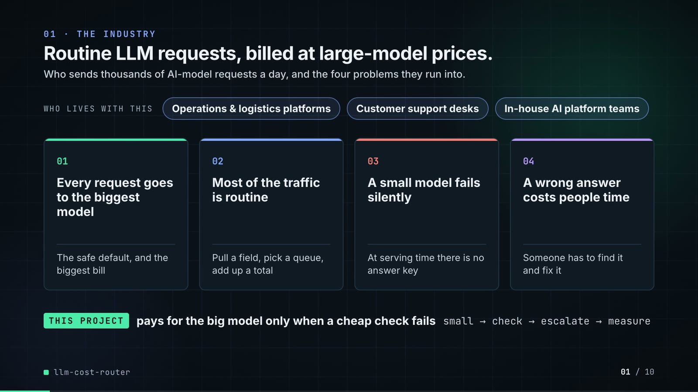

**On-screen text (verbatim)**

> 01 · THE INDUSTRY  
> Routine LLM requests, billed at large-model prices.  
> Who sends thousands of AI-model requests a day, and the four problems they run into.  
> WHO LIVES WITH THIS · Operations & logistics platforms · Customer support desks · In-house AI platform teams  
> 01 Every request goes to the biggest model — The safe default, and the biggest bill  
> 02 Most of the traffic is routine — Pull a field, pick a queue, add up a total  
> 03 A small model fails silently — At serving time there is no answer key  
> 04 A wrong answer costs people time — Someone has to find it and fix it  
> THIS PROJECT pays for the big model only when a cheap check fails · small → check → escalate → measure  

**Figures on this slide**

| ID | Shown | Source · key | Calculation | Check |
|---|---|---|---|---|
| F-01 | 3 industry chips | `author's framing` · - | - | manual |
| F-02 | 4 problem cards | `README 'The problem', 'Why it is hard'` · README lines 12-35 | - | ✓ |

**Assumptions:** A-11

**Illustrative, not data:**

- The whole slide is context; no repo figures.

**To change this slide:** Edit the chips (#ctx-c1..3) and cards (#ctx-k1..4) in compositions/s01-context.html. (project folder `docs/demo/source`).

### Slide 02: This project  
*6.8-11.6 s · composition `compositions/s02-hook.html`*

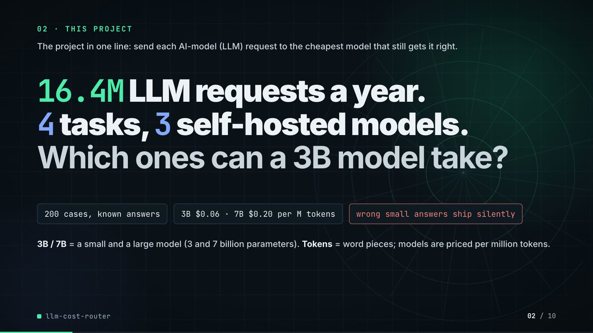

**On-screen text (verbatim)**

> 02 · THIS PROJECT  
> The project in one line: send each AI-model (LLM) request to the cheapest model that still gets it right.  
> 16.4M LLM requests a year. 4 tasks, 3 self-hosted models. Which ones can a 3B model take?  
> 200 cases, known answers · 3B $0.06 · 7B $0.20 per M tokens · wrong small answers ship silently  
> 3B / 7B = a small and a large model (3 and 7 billion parameters). Tokens = word pieces; models are priced per million tokens.  

**Figures on this slide**

| ID | Shown | Source · key | Calculation | Check |
|---|---|---|---|---|
| F-03 | 16.4M LLM requests a year / 16.4M / yr / 16.4M req | `outputs/results.json` · annual_requests (sum over 4 tasks = 16,394,979) | sum / 1e6, 1 decimal | ✓ |
| F-04 | 4 tasks | `outputs/results.json` · policy (one entry per task type) | count | ✓ |
| F-05 | 3 self-hosted models / 3 models | `outputs/results.json` · model_seconds (one entry per model) | count | ✓ |
| F-06 | 200 cases, known answers | `data/eval_suite.jsonl` · line count; every case has an 'answer' | count | ✓ |
| F-07 | 3B $0.06 · 7B $0.20 per M tokens | `src/llm_cost_router/config.py:35-37` · MODELS usd_per_m_* | - | ✓ |
| F-08 | wrong small answers ship silently | `outputs/results.json` · splits.test['router, structural check only'].wrong_accepted_small = 27 | > 0 | ✓ |

**Assumptions:** A-01, A-02, A-07

**Illustrative, not data:**

- Rings in the background are decoration.

**To change this slide:** Headline spans #hook-l1..l3 and chips #hook-f1..f3 in compositions/s02-hook.html. (project folder `docs/demo/source`).

### Slide 03: How it works (white chapter, slide A)  
*11.3-19.3 s · composition `compositions/explainer.html (CONFIG.blocks, CONFIG.groups)`*

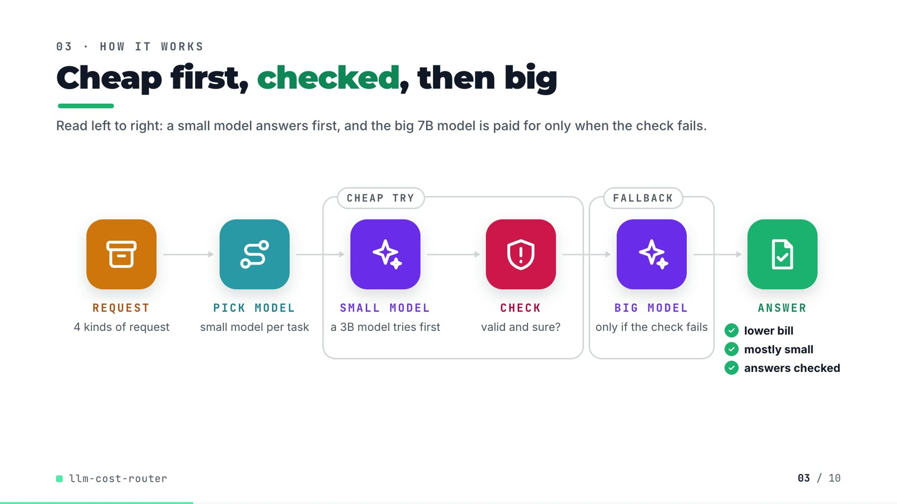

**On-screen text (verbatim)**

> 03 · HOW IT WORKS  
> Cheap first, checked, then big  
> Read left to right: a small model answers first, and the big 7B model is paid for only when the check fails.  
> REQUEST 4 kinds of request → PICK MODEL small model per task → [CHEAP TRY: SMALL MODEL a 3B model tries first → CHECK valid and sure?] → [FALLBACK: BIG MODEL only if the check fails] → ANSWER ✓ lower bill ✓ mostly small ✓ answers checked  

**Figures on this slide**

| ID | Shown | Source · key | Calculation | Check |
|---|---|---|---|---|
| F-09 | lower bill / mostly small / answers checked | `outputs/results.json; src/llm_cost_router/router.py:61` · cost_per_1k_usd router < all-large; share_answered_small > 0.5; verify() runs on every small answer | - | ✓ |
| F-10 | ≤ 2 calls / request; FALLBACK | `src/llm_cost_router/router.py:54-66; README 'Stop condition'` · route(): one optional small call, one large call | - | ✓ |

**Assumptions:** A-02, A-04

**Illustrative, not data:**

- Icons and colours are a visual language, not data.

**To change this slide:** Edit CONFIG in compositions/explainer.html; badge truth is F-09. (project folder `docs/demo/source`).

### Slide 04: The key idea (white chapter, slide B)  
*19.3-26.3 s · composition `compositions/explainer.html (#ex-b)`*

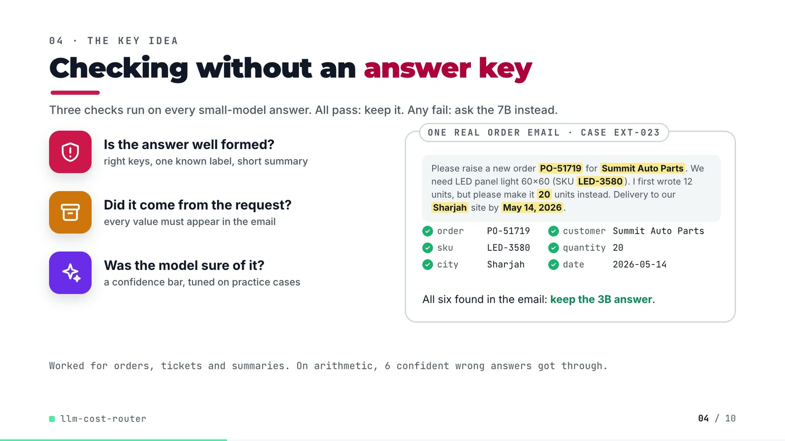

**On-screen text (verbatim)**

> 04 · THE KEY IDEA  
> Checking without an answer key  
> Three checks run on every small-model answer. All pass: keep it. Any fail: ask the 7B instead.  
> Is the answer well formed? — right keys, one known label, short summary  
> Did it come from the request? — every value must appear in the email  
> Was the model sure of it? — a confidence bar, tuned on practice cases  
> ONE REAL ORDER EMAIL · CASE EXT-023: 'Please raise a new order PO-51719 for Summit Auto Parts. We need LED panel light 60x60 (SKU LED-3580). I first wrote 12 units, but please make it 20 units instead. Delivery to our Sharjah site by May 14, 2026.' → order PO-51719 ✓ customer Summit Auto Parts ✓ sku LED-3580 ✓ quantity 20 ✓ city Sharjah ✓ date 2026-05-14 ✓ · All six found in the email: keep the 3B answer.  
> Worked for orders, tickets and summaries. On arithmetic, 6 confident wrong answers got through.  

**Figures on this slide**

| ID | Shown | Source · key | Calculation | Check |
|---|---|---|---|---|
| F-11 | PO-51719 · Summit Auto Parts · LED-3580 · 20 · Sharjah · 2026-05-14; keep the 3B answer | `demo:assets/routing_log.json (export of the repo's Router)` · id = ext-023: first_model, check_passed, escalated, output, input | - | ✓ |
| F-12 | 6 confident wrong answers got through / 6 wrong answers passed at over 99.99% confidence | `outputs/per_case.csv; demo:assets/routing_log.json` · arm = router, tuned on dev; task = reasoning; escalated = False; correct = False | count = 6; every confidence > 0.9999 | ✓ |
| F-13 | Worked for orders, tickets and summaries | `outputs/results.json` · splits.test[arm].by_task[task].completion | router ≥ all-large for 3 tasks | ✓ |

**Assumptions:** A-04, A-05

**Illustrative, not data:**

- The email is an excerpt of case ext-023 (greeting, previous-order line, phone number and sign-off omitted); the six ticks show verify_extraction's grounding rule, which checks every value.

**To change this slide:** Markup under #ex-b in compositions/explainer.html; the footnote figures are F-12 and F-13. (project folder `docs/demo/source`).

### Slide 05: Architecture  
*26.0-41.0 s · composition `compositions/s03-architecture.html`*

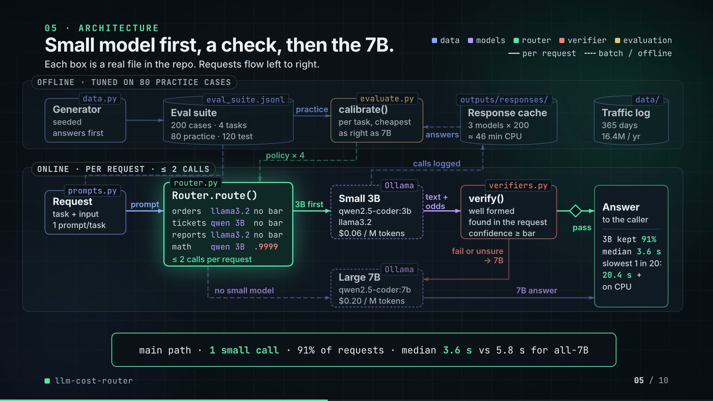

**On-screen text (verbatim)**

> 05 · ARCHITECTURE  
> Small model first, a check, then the 7B.  
> Each box is a real file in the repo. Requests flow left to right.  
> OFFLINE · TUNED ON 80 PRACTICE CASES: data.py Generator (seeded, answers first) → eval_suite.jsonl Eval suite (200 cases · 4 tasks, 80 practice · 120 test) → practice → evaluate.py calibrate() (per task, cheapest as right as 7B) ← answers ← outputs/responses/ Response cache (3 models × 200, ≈ 46 min CPU) · data/ Traffic log (365 days, 16.4M / yr)  
> ONLINE · PER REQUEST · ≤ 2 CALLS: prompts.py Request (task + input, 1 prompt/task) → prompt → router.py Router.route() [orders llama3.2 no bar · tickets qwen 3B no bar · reports llama3.2 no bar · math qwen 3B .9999 · ≤ 2 calls per request] → 3B first → Ollama Small 3B (qwen2.5-coder:3b, llama3.2, $0.06 / M tokens) → text + odds → verifiers.py verify() (well formed, found in the request, confidence ≥ bar) → pass → Answer (to the caller · 3B kept 91% · median 3.6 s · slowest 1 in 20: 20.4 s + · on CPU)  
> fail or unsure → 7B → Ollama Large 7B (qwen2.5-coder:7b, $0.20 / M tokens) → 7B answer → Answer · no small model → Large 7B · policy × 4 (calibrate → Router) · calls logged (Small 3B → Response cache)  
> EVALUATION · REPLAYS SAVED ANSWERS · make run < 1 s: evaluate.py Replay (6 setups · 120 test) → grading.py Answer key (the router never sees it) → right? → summarise() Score (completion · cost) → paired_bootstrap() Bootstrap (95% range · 4,000×) → outputs/ results.json, per_case.csv  
> main path · 1 small call · 91% of requests · median 3.6 s vs 5.8 s for all-7B (the evaluation lane is hidden behind this callout)  
> Legend: data · models · router · verifier · evaluation · per request (solid) · batch / offline (dashed)  

**Figures on this slide**

| ID | Shown | Source · key | Calculation | Check |
|---|---|---|---|---|
| F-03 | 16.4M LLM requests a year / 16.4M / yr / 16.4M req | `outputs/results.json` · annual_requests (sum over 4 tasks = 16,394,979) | sum / 1e6, 1 decimal | ✓ |
| F-04 | 4 tasks | `outputs/results.json` · policy (one entry per task type) | count | ✓ |
| F-05 | 3 self-hosted models / 3 models | `outputs/results.json` · model_seconds (one entry per model) | count | ✓ |
| F-06 | 200 cases, known answers | `data/eval_suite.jsonl` · line count; every case has an 'answer' | count | ✓ |
| F-07 | 3B $0.06 · 7B $0.20 per M tokens | `src/llm_cost_router/config.py:35-37` · MODELS usd_per_m_* | - | ✓ |
| F-10 | ≤ 2 calls / request; FALLBACK | `src/llm_cost_router/router.py:54-66; README 'Stop condition'` · route(): one optional small call, one large call | - | ✓ |
| F-14 | 80 practice · 120 test (practice = the dev split) | `data/eval_suite.jsonl` · split | count per split | ✓ |
| F-15 | 3 models × 200 | `outputs/responses/*.jsonl` · line counts | 200 lines in each of 3 files | ✓ |
| F-16 | ≈ 46 min CPU | `outputs/results.json` · model_seconds (796.1 + 706.2 + 1240.3 s) | sum / 60 = 45.8 min, rounded | ✓ |
| F-17 | 365 days | `data/traffic_daily.csv` · row count | - | ✓ |
| F-18 | data.py, eval_suite.jsonl, evaluate.py calibrate(), outputs/responses/, data/, prompts.py, router.py Router.route(), Ollama (client.py), verifiers.py verify(), grading.py, summarise(), paired_bootstrap(), outputs/results.json, per_case.csv | `src/llm_cost_router/*.py; data/; outputs/` · file / def | - | ✓ |
| F-19 | Router.route() table: orders llama3.2 no bar · tickets qwen 3B no bar · reports llama3.2 no bar · math qwen 3B .9999 (bar = confidence threshold τ) | `outputs/results.json` · policy[task].first, policy[task].threshold | - | ✓ |
| F-20 | well formed / found in the request / confidence ≥ bar | `src/llm_cost_router/verifiers.py:59-149; router.py:62` · verify_* functions; verdict.confidence >= policy.threshold | - | ✓ |
| F-21 | 3B kept 91% / 91% of requests / 91% | `outputs/results.json` · splits.test['router, tuned on dev'].share_answered_small = 0.9083 | x 100, whole number | ✓ |
| F-22 | median 3.6 s · slowest 1 in 20: 20.4 s + (median = p50, slowest 1 in 20 = p95) | `outputs/results.json` · splits.test['router, tuned on dev'].p50_latency_s, p95_latency_s | 1 decimal | ✓ |
| F-23 | median 3.6 s vs 5.8 s for all-7B | `outputs/results.json` · splits.test['all-large qwen2.5-coder:7b'].p50_latency_s | 1 decimal | ✓ |
| F-24 | Replay · 6 setups · 120 test | `outputs/results.json` · splits.test arms with a completion | count | ✓ |
| F-25 | make run < 1 s / replays … in under a second | `outputs/run_log.txt:85` · 'make run ... 0.469 total' | total < 1 s | ✓ |
| F-26 | 95% range · 4,000× | `src/llm_cost_router/evaluate.py:136` · reps: int = 4000 | - | ✓ |
| F-27 | per task, the cheapest ≥ 7B | `src/llm_cost_router/evaluate.py:105-122` · options below large completion are skipped; key = (cost, -completion, threshold) | - | ✓ |

**Assumptions:** A-01, A-02, A-03, A-04, A-06, A-08, A-09

**Illustrative, not data:**

- Packets moving along the wires are a schematic of execution order; 1 escalation in 11 packets approximates the 11 / 120 escalation share, not real traffic.
- 'Ollama' marks the model calls made by client.py; the evaluation replays the same calls from the cache.
- The 'no small model' path exists in router.py (TaskPolicy first=None) but the tuned policy does not use it for any task.
- The critical-path p50 (3.6 s) is the router's median over all held-out requests, including escalated ones.

**To change this slide:** Node boxes (#n-*) and the edge table E in compositions/s03-architecture.html. (project folder `docs/demo/source`).

### Slide 06: The system running  
*40.6-53.0 s · composition `compositions/s04-routes.html (GRID block injected by tools/inject_sheet.py)`*

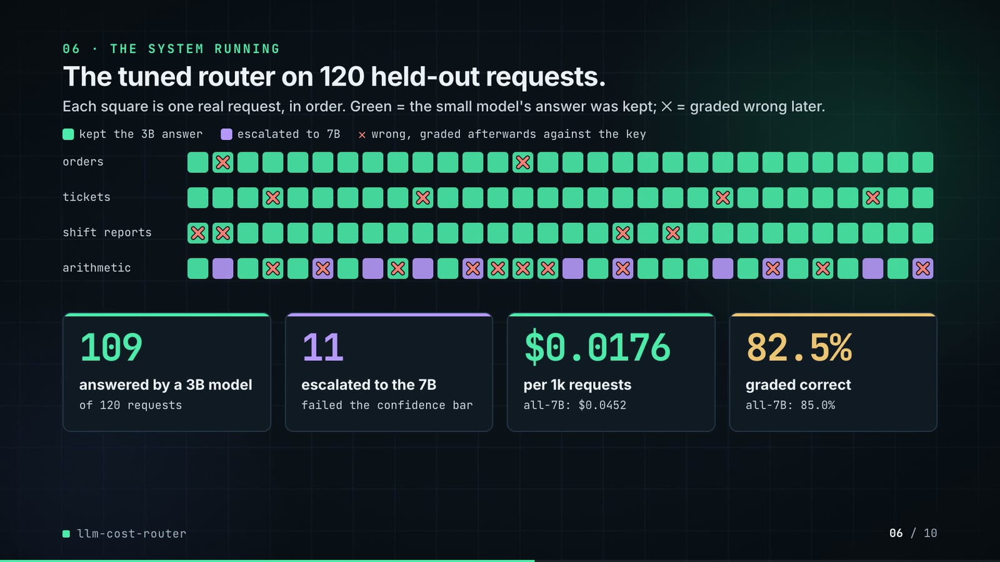

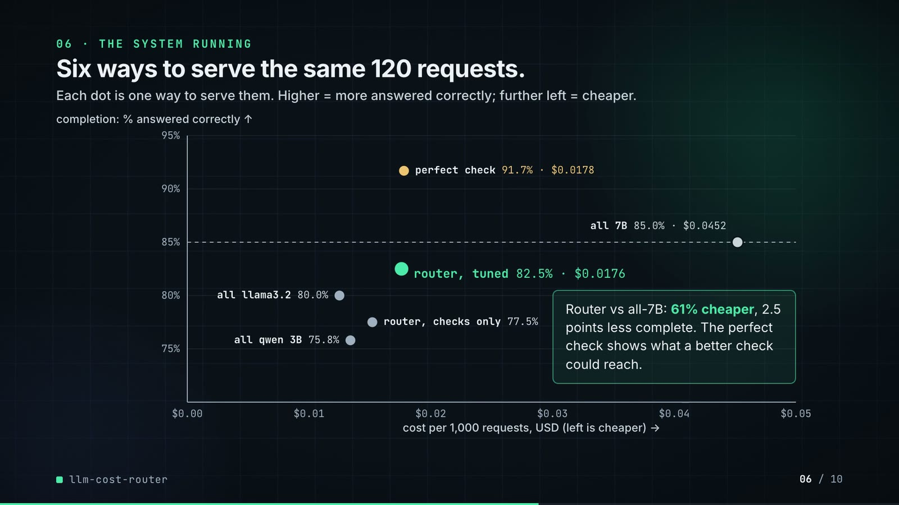

**On-screen text (verbatim)**

> 06 · THE SYSTEM RUNNING  
> Phase 1: The tuned router on 120 held-out requests. Each square is one real request, in order. Green = the small model's answer was kept; ✕ = graded wrong later. · kept the 3B answer · escalated to 7B · ✕ wrong, graded afterwards against the key · rows orders / tickets / shift reports / arithmetic (30 cells each)  
> 109 answered by a 3B model (of 120 requests) · 11 escalated to the 7B (failed the confidence bar) · $0.0176 per 1k requests (all-7B: $0.0452) · 82.5% graded correct (all-7B: 85.0%)  
> Phase 2: Six ways to serve the same 120 requests. Each dot is one way to serve them. Higher = more answered correctly; further left = cheaper. Axes: completion: % answered correctly ↑ · cost per 1,000 requests, USD (left is cheaper) →. all qwen 3B 75.8% · all llama3.2 80.0% · router, checks only 77.5% · router, tuned 82.5% · $0.0176 · perfect check 91.7% · $0.0178 · all 7B 85.0% · $0.0452; dashed line at the all-7B completion.  
> Router vs all-7B: 61% cheaper, 2.5 points less complete. The perfect check shows what a better check could reach.  

**Figures on this slide**

| ID | Shown | Source · key | Calculation | Check |
|---|---|---|---|---|
| F-21 | 3B kept 91% / 91% of requests / 91% | `outputs/results.json` · splits.test['router, tuned on dev'].share_answered_small = 0.9083 | x 100, whole number | ✓ |
| F-28 | 120 held-out requests | `outputs/results.json` · splits.test['router, tuned on dev'].n | - | ✓ |
| F-29 | 109 / 109 answered by 3B / 109 of 120 requests | `outputs/per_case.csv` · arm = router, tuned on dev; escalated = False | count | ✓ |
| F-30 | 11 / 11 escalated | `outputs/per_case.csv` · arm = router, tuned on dev; escalated = True | count | ✓ |
| F-31 | $0.0176 | `outputs/results.json` · splits.test['router, tuned on dev'].cost_per_1k_usd = 0.0175998 | 4 decimals | ✓ |
| F-32 | $0.0452 | `outputs/results.json` · splits.test['all-large qwen2.5-coder:7b'].cost_per_1k_usd = 0.045235 | 4 decimals | ✓ |
| F-33 | 82.5% | `outputs/results.json` · splits.test['router, tuned on dev'].completion = 0.825 | x 100, 1 decimal | ✓ |
| F-34 | 85.0% | `outputs/results.json` · splits.test['all-large qwen2.5-coder:7b'].completion = 0.85 | x 100, 1 decimal | ✓ |
| F-35 | 120-cell grid | `outputs/per_case.csv; demo:compositions/s04-routes.html (GRID block)` · arm = router, tuned on dev: task, escalated, correct | cell-by-cell equality | ✓ |
| F-36 | failed the confidence bar | `demo:assets/routing_log.json (export of the repo's Router)` · escalated rows: check_passed, confidence < threshold | - | ✓ |
| F-37 | all qwen 3B 75.8% · all llama3.2 80.0% · all 7B 85.0% · $0.0452 · router, checks only 77.5% · router, tuned 82.5% · $0.0176 · perfect check 91.7% · $0.0178 (perfect check = the oracle arm) | `outputs/results.json; demo:compositions/s04-routes.html (GRID.arms)` · splits.test[arm].completion, cost_per_1k_usd | 1 decimal %, 4 decimals $ | ✓ |
| F-38 | 61% cheaper / About 61% cheaper / −61% | `outputs/results.json` · cost_per_1k_usd: router 0.0175998, all-large 0.045235 | (router / all-large − 1) x 100 = −61.1% | ✓ |
| F-39 | 2.5 points less complete | `outputs/results.json` · completion: router 0.825, all-large 0.85 | (0.85 − 0.825) x 100 = 2.5 | ✓ |

**Assumptions:** A-02, A-04, A-05, A-10

**To change this slide:** Re-run export_routing_log.py and inject_sheet.py; layout constants in compositions/s04-routes.html. (project folder `docs/demo/source`).

### Slide 07: End-user value  
*52.7-65.7 s · composition `compositions/value.html (SHEET block injected by tools/inject_sheet.py)`*

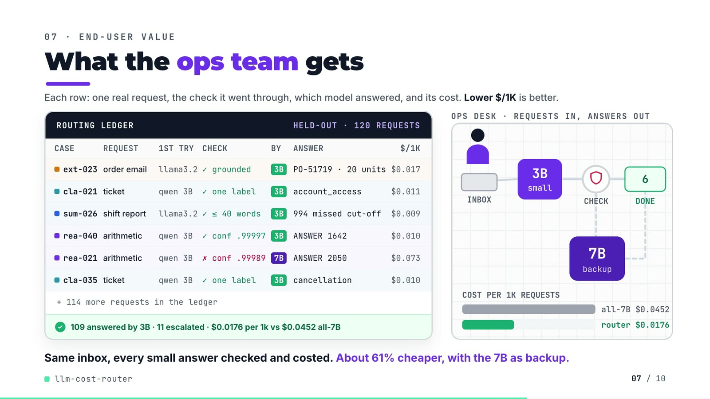

**On-screen text (verbatim)**

> 07 · END-USER VALUE  
> What the ops team gets  
> Each row: one real request, the check it went through, which model answered, and its cost. Lower $/1K is better.  
> ROUTING LEDGER · HELD-OUT · 120 REQUESTS · CASE / REQUEST / 1ST TRY / CHECK / BY / ANSWER / $/1K  
> ext-023 order email llama3.2 ✓ grounded 3B PO-51719 · 20 units $0.017  
> cla-021 ticket qwen 3B ✓ one label 3B account_access $0.011  
> sum-026 shift report llama3.2 ✓ ≤ 40 words 3B 994 missed cut-off $0.009  
> rea-040 arithmetic qwen 3B ✓ conf .99997 3B ANSWER 1642 $0.010  
> rea-021 arithmetic qwen 3B ✗ conf .99989 7B ANSWER 2050 $0.073  
> cla-035 ticket qwen 3B ✓ one label 3B cancellation $0.010  
> + 114 more requests in the ledger · ✓ 109 answered by 3B · 11 escalated · $0.0176 per 1k vs $0.0452 all-7B  
> Scene: OPS DESK · REQUESTS IN, ANSWERS OUT — INBOX → 3B small → CHECK → DONE (count 0..6); rea-021 detours through 7B backup · COST PER 1K REQUESTS all-7B $0.0452 / router $0.0176  
> Same inbox, every small answer checked and costed. About 61% cheaper, with the 7B as backup.  

**Figures on this slide**

| ID | Shown | Source · key | Calculation | Check |
|---|---|---|---|---|
| F-11 | PO-51719 · Summit Auto Parts · LED-3580 · 20 · Sharjah · 2026-05-14; keep the 3B answer | `demo:assets/routing_log.json (export of the repo's Router)` · id = ext-023: first_model, check_passed, escalated, output, input | - | ✓ |
| F-28 | 120 held-out requests | `outputs/results.json` · splits.test['router, tuned on dev'].n | - | ✓ |
| F-29 | 109 / 109 answered by 3B / 109 of 120 requests | `outputs/per_case.csv` · arm = router, tuned on dev; escalated = False | count | ✓ |
| F-30 | 11 / 11 escalated | `outputs/per_case.csv` · arm = router, tuned on dev; escalated = True | count | ✓ |
| F-31 | $0.0176 | `outputs/results.json` · splits.test['router, tuned on dev'].cost_per_1k_usd = 0.0175998 | 4 decimals | ✓ |
| F-32 | $0.0452 | `outputs/results.json` · splits.test['all-large qwen2.5-coder:7b'].cost_per_1k_usd = 0.045235 | 4 decimals | ✓ |
| F-38 | 61% cheaper / About 61% cheaper / −61% | `outputs/results.json` · cost_per_1k_usd: router 0.0175998, all-large 0.045235 | (router / all-large − 1) x 100 = −61.1% | ✓ |
| F-40 | 6 ledger rows | `demo:assets/routing_log.json; outputs/per_case.csv; demo:compositions/value.html (SHEET block)` · per case: first_model, check_passed, confidence, escalated, output, cost_usd | $ per 1k = cost_usd x 1000, 3 decimals | ✓ |
| F-41 | + 114 more requests in the ledger | `outputs/results.json` · n = 120 minus the 6 rows shown | 120 − 6 | ✓ |

**Assumptions:** A-02, A-04, A-05, A-10

**Illustrative, not data:**

- The ledger is a presentation of the router's real per-request log; the repo writes outputs/per_case.csv, not a ledger file.
- The six rows were picked to show each task and one escalation; they are not a random sample (16 of the 109 kept answers were wrong, see slide 09).
- '994 missed cut-off' condenses the summary's reported count; the full summary text is in the routing log.
- The person, inbox, trays and envelopes are a schematic of the routing flow.

**To change this slide:** Pick rows with inject_sheet.py --rows; scene geometry in CONFIG in compositions/value.html. (project folder `docs/demo/source`).

### Slide 08: Results  
*65.4-74.2 s · composition `compositions/s05-results.html`*

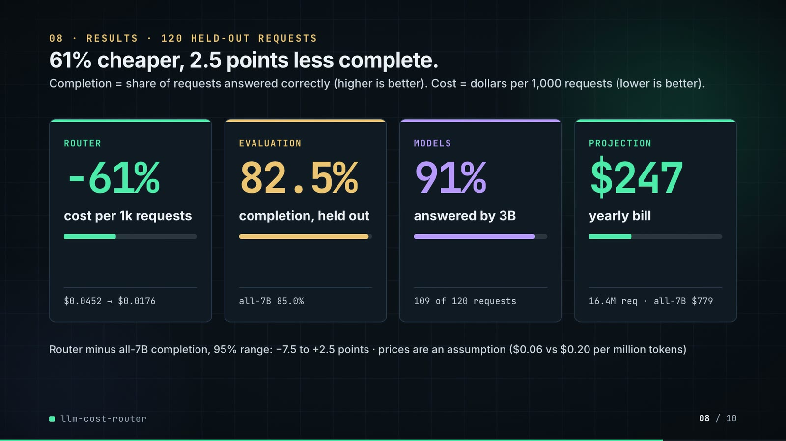

**On-screen text (verbatim)**

> 08 · RESULTS · 120 HELD-OUT REQUESTS  
> 61% cheaper, 2.5 points less complete.  
> Completion = share of requests answered correctly (higher is better). Cost = dollars per 1,000 requests (lower is better).  
> router −61% cost per 1k requests ($0.0452 → $0.0176)  
> evaluation 82.5% completion, held out (all-7B 85.0%)  
> models 91% answered by 3B (109 of 120 requests)  
> projection $247 yearly bill (16.4M req · all-7B $779)  
> Router minus all-7B completion, 95% range: −7.5 to +2.5 points · prices are an assumption ($0.06 vs $0.20 per million tokens)  

**Figures on this slide**

| ID | Shown | Source · key | Calculation | Check |
|---|---|---|---|---|
| F-03 | 16.4M LLM requests a year / 16.4M / yr / 16.4M req | `outputs/results.json` · annual_requests (sum over 4 tasks = 16,394,979) | sum / 1e6, 1 decimal | ✓ |
| F-07 | 3B $0.06 · 7B $0.20 per M tokens | `src/llm_cost_router/config.py:35-37` · MODELS usd_per_m_* | - | ✓ |
| F-21 | 3B kept 91% / 91% of requests / 91% | `outputs/results.json` · splits.test['router, tuned on dev'].share_answered_small = 0.9083 | x 100, whole number | ✓ |
| F-29 | 109 / 109 answered by 3B / 109 of 120 requests | `outputs/per_case.csv` · arm = router, tuned on dev; escalated = False | count | ✓ |
| F-31 | $0.0176 | `outputs/results.json` · splits.test['router, tuned on dev'].cost_per_1k_usd = 0.0175998 | 4 decimals | ✓ |
| F-32 | $0.0452 | `outputs/results.json` · splits.test['all-large qwen2.5-coder:7b'].cost_per_1k_usd = 0.045235 | 4 decimals | ✓ |
| F-33 | 82.5% | `outputs/results.json` · splits.test['router, tuned on dev'].completion = 0.825 | x 100, 1 decimal | ✓ |
| F-34 | 85.0% | `outputs/results.json` · splits.test['all-large qwen2.5-coder:7b'].completion = 0.85 | x 100, 1 decimal | ✓ |
| F-38 | 61% cheaper / About 61% cheaper / −61% | `outputs/results.json` · cost_per_1k_usd: router 0.0175998, all-large 0.045235 | (router / all-large − 1) x 100 = −61.1% | ✓ |
| F-39 | 2.5 points less complete | `outputs/results.json` · completion: router 0.825, all-large 0.85 | (0.85 − 0.825) x 100 = 2.5 | ✓ |
| F-42 | 95% range: −7.5 to +2.5 points | `outputs/results.json` · splits.test.router_minus_large_ci95 = [-0.075, 0.025] | x 100, 1 decimal | ✓ |
| F-43 | $247 / all-7B $779 | `outputs/results.json` · splits.test[arm].projected_annual_cost_usd: 246.65, 778.78 | whole dollars | ✓ |

**Assumptions:** A-02, A-04, A-07, A-08, A-10

**Illustrative, not data:**

- Mini bars are ratios to the all-7B baseline (or to 120 requests for the 91% card).

**To change this slide:** The stats array and card text in compositions/s05-results.html. (project folder `docs/demo/source`).

### Slide 09: Lesson and fix  
*73.8-82.8 s · composition `compositions/s06-twist.html`*

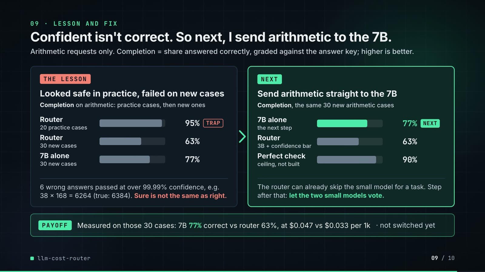

**On-screen text (verbatim)**

> 09 · LESSON AND FIX  
> Confident isn't correct. So next, I send arithmetic to the 7B.  
> Arithmetic requests only. Completion = share answered correctly, graded against the answer key; higher is better.  
> THE LESSON · Looked safe in practice, failed on new cases · Completion on arithmetic: practice cases, then new ones  
> Router (20 practice cases) 95% TRAP · Router (30 new cases) 63% · 7B alone (30 new cases) 77%  
> 6 wrong answers passed at over 99.99% confidence, e.g. 38 × 168 = 6264 (true: 6384). Sure is not the same as right.  
> NEXT · Send arithmetic straight to the 7B · Completion, the same 30 new arithmetic cases  
> 7B alone (the next step) 77% NEXT · Router (3B + confidence bar) 63% · Perfect check (ceiling, not built) 90%  
> The router can already skip the small model for a task. Step after that: let the two small models vote.  
> PAYOFF · Measured on those 30 cases: 7B 77% correct vs router 63%, at $0.047 vs $0.033 per 1k · not switched yet  

**Figures on this slide**

| ID | Shown | Source · key | Calculation | Check |
|---|---|---|---|---|
| F-12 | 6 confident wrong answers got through / 6 wrong answers passed at over 99.99% confidence | `outputs/per_case.csv; demo:assets/routing_log.json` · arm = router, tuned on dev; task = reasoning; escalated = False; correct = False | count = 6; every confidence > 0.9999 | ✓ |
| F-44 | Router · 20 practice cases · 95% (TRAP) | `outputs/results.json` · policy.reasoning.dev_completion = 0.95 (and dev_large_completion = 0.95) | x 100, whole number | ✓ |
| F-45 | 38 × 168 = 6264 (true: 6384) | `outputs/responses/qwen2.5-coder_3b.jsonl; demo:assets/routing_log.json` · case rea-028 | 38 x 168 = 6384; 6384 + 45 = 6429 | ✓ |
| F-46 | 63% / 77% / 90% | `outputs/results.json` · splits.test[arm].by_task.reasoning.completion = 0.6333 / 0.7667 / 0.9 | x 100, whole numbers | ✓ |
| F-47 | 20 practice cases · 30 new cases | `data/eval_suite.jsonl; outputs/results.json` · split per task = reasoning; splits.test[router].by_task.reasoning.n | count | ✓ |
| F-48 | bars 95 / 63 / 77 (left), 77 / 63 / 90 (right) | `demo:compositions/s06-twist.html` · style width of #twist-lb1..3 and #twist-rb1..3 | round(2.6 x completion %) | ✓ |
| F-49 | 7B 77% correct vs router 63%, at $0.047 vs $0.033 per 1k | `outputs/results.json` · splits.test[arm].by_task.reasoning.completion, cost_per_1k_usd (0.04701 / 0.03278) | whole %, $ to 3 decimals | ✓ |
| F-50 | NEXT · The router can already skip the small model for a task · let the two small models vote · not switched yet | `src/llm_cost_router/router.py:20-23,55; evaluate.py:112; outputs/results.json policy; README lines 257, 380` · TaskPolicy(first=None); policy.reasoning.first; README 'I have not switched it', 'Next: send reasoning to the large model, then try agreement between the two small models' | - | ✓ |

**Assumptions:** A-02, A-04, A-05, A-10

**Illustrative, not data:**

- The arrow between the panels is decoration.
- 'Perfect check' is the oracle arm: an upper limit for a better verifier, not something the repo builds.

**To change this slide:** Panel text, bar widths (100% = 260 px, both panels) and the payoff strip in compositions/s06-twist.html; F-48 re-checks the widths. (project folder `docs/demo/source`).

### Slide 10: End card  
*82.4-86.8 s · composition `compositions/s07-end.html`*

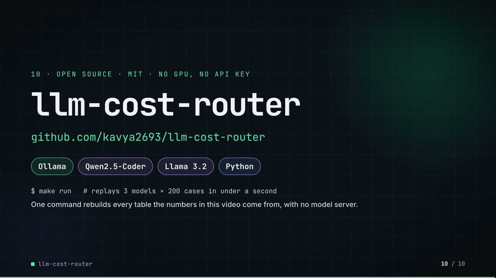

**On-screen text (verbatim)**

> 10 · OPEN SOURCE · MIT · NO GPU, NO API KEY  
> llm-cost-router  
> github.com/kavya2693/llm-cost-router  
> Ollama · Qwen2.5-Coder · Llama 3.2 · Python  
> $ make run   # replays 3 models × 200 cases in under a second  
> One command rebuilds every table the numbers in this video come from, with no model server.  

**Figures on this slide**

| ID | Shown | Source · key | Calculation | Check |
|---|---|---|---|---|
| F-05 | 3 self-hosted models / 3 models | `outputs/results.json` · model_seconds (one entry per model) | count | ✓ |
| F-06 | 200 cases, known answers | `data/eval_suite.jsonl` · line count; every case has an 'answer' | count | ✓ |
| F-15 | 3 models × 200 | `outputs/responses/*.jsonl` · line counts | 200 lines in each of 3 files | ✓ |
| F-25 | make run < 1 s / replays … in under a second | `outputs/run_log.txt:85` · 'make run ... 0.469 total' | total < 1 s | ✓ |
| F-51 | OPEN SOURCE · MIT · NO GPU, NO API KEY | `LICENSE; README 'Running it', 'Inference time'` · MIT License; 'need no model server or key'; CPU inference | - | ✓ |
| F-52 | Ollama · Qwen2.5-Coder · Llama 3.2 · Python | `src/llm_cost_router/client.py; config.py; pyproject.toml` · Ollama client; model ids; python | - | ✓ |

**Assumptions:** A-06

**To change this slide:** Text in compositions/s07-end.html. (project folder `docs/demo/source`).

## 5. Change-impact matrix

| Input / assumption | Affected figures | Affected slides | Files to edit | Commands to re-run |
|---|---|---|---|---|
| A-01: All data is synthetic, produced by a seeded generator sized to the production problem: 200 evaluation cases (50 per task type, half easy, half hard) and 365 days of request volume per task type | all figures | 01, 02, 03, 04, 05, 06, 07, 08, 09, 10 | `src/llm_cost_router/data.py; src/llm_cost_router/config.py:15` | `make data; make models (~46 min CPU) if prompts or cases change; make run` |
| A-02: Prices are an assumption, not a quote: $0 | F-07, F-09, F-31, F-32, F-37, F-38, F-40, F-43, F-49 | 02, 03, 05, 06, 07, 08, 09 | `src/llm_cost_router/config.py:34-37` | `make run; export_routing_log.py + inject_sheet.py` |
| A-03: Latency is the measured CPU inference time per request on an M1 Pro laptop shared with other jobs (model load time excluded); an escalated request waits for the small call and then the large one | F-16, F-22, F-23 | 05 | `re-collect with make models on the target machine` | `make models; make run` |
| A-04: The routing policy is tuned on the dev split only (20 cases per task type): per task, the cheapest {first small model, confidence threshold} whose dev completion is at least the 7B model's | F-12, F-13, F-14, F-19, F-21, F-27, F-28, F-29, F-30, F-31, F-33, F-35, F-36, F-37, F-38, F-39, F-40, F-42, F-44, F-46, F-47, F-48, F-49, F-50 | 04, 05, 06, 07, 08, 09 | `src/llm_cost_router/evaluate.py:102-134; DEV_PER_TYPE in src/llm_cost_router/data.py` | `make run; export_routing_log.py + inject_sheet.py` |
| A-05: Ground truth comes from the generator (answers fixed before the text is written); grading | F-08, F-12, F-13, F-33, F-34, F-35, F-37, F-39, F-42, F-44, F-45, F-46, F-47, F-48 | 02, 04, 06, 08, 09 | `src/llm_cost_router/grading.py` | `make run` |
| A-06: Models run at temperature 0 with seed 7, but multi-threaded CPU inference is not bit-for-bit deterministic; the committed response cache (outputs/responses/* | all figures | 01, 02, 03, 04, 05, 06, 07, 08, 09, 10 | `outputs/responses/*.jsonl (via make models)` | `make models; make run` |
| A-07: Annual volume is the sum of the 365-day traffic log, with logging gaps filled by the mean of the same weekday within 28 days; the projected bill multiplies each task's cost per 1k requests by its volume | F-03, F-17, F-43 | 02, 05, 08 | `src/llm_cost_router/data.py:428-446` | `make data; make run` |
| A-08: The completion interval is a paired bootstrap over the same 120 cases, 4,000 resamples, seed 0 | F-26, F-42 | 05, 08 | `src/llm_cost_router/evaluate.py:136` | `make run` |
| A-09: Output caps per task (160, 8, 90, 220 tokens) keep a full collection run under an hour on CPU; a truncated reasoning answer fails its check | F-16 | 05 | `src/llm_cost_router/config.py:44` | `make models; make run` |
| A-10: Video rounding: percentages to whole numbers or 1 decimal, dollars per 1k to 4 decimals, per-request costs as $ per 1k to 3 decimals, the yearly bill to whole dollars, 16 | F-03, F-16, F-21, F-22, F-23, F-31, F-32, F-33, F-34, F-37, F-38, F-39, F-40, F-43, F-44, F-46, F-47, F-48, F-49 | 02, 05, 06, 07, 08, 09 | `the composition file named on each slide` | `hyperframes render` |
| A-11: Slide 01 (industry, everyday problems) is general knowledge about running LLMs in operations, used as context | F-01, F-02 | 01 | `compositions/s01-context.html` | `hyperframes render` |

## 6. Known differences and caveats

- The repo's results are on a synthetic suite (A-01); the 16.4M requests a year is the generator's traffic log, not a measured production volume.
- Prices are an assumption (A-02). Every cost figure (61%, $0.0176, $0.0452, $247, $779, the per-row $/1k) scales with the price table.
- The router is 2.5 points less complete than all-7B on the held-out split, with a 95% interval of [−7.5, +2.5]; the slides state the deficit, they do not claim parity.
- 16 of the 109 kept 3B answers were wrong (outputs/results.md 'Wrong answers let through'); the ledger on slide 07 shows six chosen rows, all graded correct.
- Latency is CPU time on a shared laptop (A-03); the router's p95 (20.4 s) is worse than all-7B's (12.6 s) because an escalation pays for two calls. The video shows p95 on slide 05 only.
- routing_log.json is produced by the demo's export script calling the repo's own calibrate() and Router on the committed cache; F-35 and F-40 cross-check it against outputs/per_case.csv.
- Slide 01 statements are general knowledge (A-11).
- Slide 09's right panel is labelled NEXT because the repo does not implement the fix as policy: the tuned policy still starts arithmetic on qwen 3B. The 77% and $0.047 are the measured all-7B arm on the same 30 held-out arithmetic cases, not a re-tuned router; switching on that evidence would be a test-split decision, which is why README 'What this says' item 2 leaves it unswitched. The second step (two small models voting) is untested.
- Slide 09 no longer shows the per-task comparison for orders, tickets and shift reports (router 93 / 87 / 87% vs all-7B 93 / 87 / 83%); README 'The result' and outputs/results.md still report it, and slide 04's footnote states the conclusion (F-13).
- Slide 05 shows the confidence threshold τ as 'bar' and the dev split as 'practice' cases; p50 / p95 are shown as 'median' and 'slowest 1 in 20'.

## Appendix: environment

- Commit: `2ec9b2fce927432c4f8445ad43a97a3a20d56942`
- Python: 3.11.7
- llm_cost_router 0.1.0
- Profile / seeds: suite_and_traffic=20261013, ollama_seed=7, temperature=0, bootstrap_seed=0
- Run time: make run replays the committed response cache in 0.47 s (outputs/run_log.txt); refreshing the cache with make models took 45.8 min of CPU inference (13.3 + 11.8 + 20.7 min)
